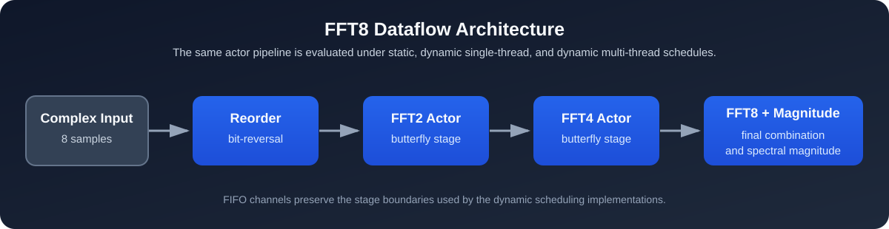

# FFT8 Hardware-Software Co-Design

Course project exploring scheduling choices for an 8-point radix-2 Fast Fourier Transform (FFT). The project expresses the transform as a small streaming pipeline and implements three execution approaches around the same computational stages.

## Abstract

This project studies how a fixed signal-processing workload can be mapped to different scheduling models without changing the underlying FFT computation. An 8-point complex FFT is partitioned into reorder, FFT2, FFT4, and FFT8-plus-magnitude stages. The stages are evaluated as a direct static schedule, a FIFO-driven dynamic schedule in one thread, and a FIFO-driven multi-threaded schedule coordinated in round-robin order. The result is a compact codebase for examining the relationship between dataflow decomposition, scheduling policy, and software execution structure in a hardware-software co-design context.



## Project focus

The implementation models the FFT as a sequence of actors connected by FIFO channels:

1. bit-reversal reordering;
2. radix-2 butterfly stage;
3. radix-4 butterfly stage; and
4. final radix-8 combination with magnitude calculation.

The repository compares three scheduling strategies:

| Implementation | Approach |
| --- | --- |
| `static_scheduler` | Direct, statically ordered execution of the FFT stages. |
| `dynamic_single_thread` | FIFO-driven actor scheduling in one thread. |
| `dynamic_multi_thread` | FIFO-driven actors coordinated across threads with round-robin scheduling. |

The `benchmark/` directory contains the original benchmarking implementations and a process-level benchmark driver for comparing the executable variants. Benchmark configuration and resource requirements are intentionally left as supplied by the student project; no benchmark result is claimed in this repository unless it is reproduced in the target environment.

## Design details

### Data representation and transform stages

Each input sample is represented as `std::complex<double>`. The pipeline first applies the 3-bit reversal order required by the iterative radix-2 FFT, then performs the butterfly operations needed to form 2-point and 4-point sub-transforms. The final stage applies the FFT8 twiddle factors, produces the complex frequency-domain output, and prints the magnitude of every bin.

### Scheduling variants

The static implementation expresses the stage order directly in one program flow. The dynamic single-thread implementation represents stages as actors that fire when enough data is available in their input FIFO. The dynamic multi-thread implementation assigns one actor to each thread and coordinates execution with a condition variable and round-robin turn-taking. Keeping the transform stages aligned across these versions makes the scheduler the central point of comparison.

### Benchmark sources

The repository retains the benchmark programs from the final project version. They generate or accept multiple FFT8 input sets and report elapsed execution time for their respective implementation. Some benchmark configurations are intentionally large and should be reviewed for memory and runtime suitability before execution on a given machine.

## Sample result

All three implementations use the following default input when no command-line values are supplied:

```text
[1 + j0, 1 + j0, 1 + j0, 1 + j0, 0 + j0, 0 + j0, 0 + j0, 0 + j0]
```

The reference FFT result below is rounded to six decimal places. It provides a quick correctness check after building and running an implementation; insignificant differences in the last digits are expected from floating-point arithmetic.

```text
Bin    Complex output                    Magnitude
X[0]   4.000000 + j0.000000              4.000000
X[1]   1.000000 - j2.414214              2.613126
X[2]   0.000000 + j0.000000              0.000000
X[3]   1.000000 - j0.414214              1.082392
X[4]   0.000000 + j0.000000              0.000000
X[5]   1.000000 + j0.414214              1.082392
X[6]   0.000000 + j0.000000              0.000000
X[7]   1.000000 + j2.414214              2.613126
```

This is a functional output check, not a performance measurement. Timing results depend on compiler, operating system, hardware, and the selected benchmark configuration.

## Repository layout

```text
src/
  static_scheduler.cpp          Static FFT8 schedule
  dynamic_single_thread.cpp     Dynamic single-thread scheduler
  dynamic_multi_thread.cpp      Dynamic multi-thread scheduler
benchmark/
  Benchmark_*.cpp               Per-strategy benchmark implementations
  fft_benchmark.cpp             Executable-level benchmark driver
CMakeLists.txt                  CMake build definition
```

## Build

Requirements: a C++17 compiler and CMake 3.16 or newer.

```powershell
cmake -S . -B build
cmake --build build --config Release
```

Run any of the three FFT implementations without arguments to use the included sample input:

```powershell
.\build\Release\static_scheduler.exe
.\build\Release\dynamic_single_thread.exe
.\build\Release\dynamic_multi_thread.exe
```

Each program also accepts sixteen numeric command-line values: real and imaginary components for eight complex input samples, in order.

## Notes on provenance and scope

This is a course project for Hardware-Software Co-Design. The source files in `src/` and `benchmark/` are the complete final source set selected from the original project folders, preserved without changes to their algorithmic implementation. Repository metadata, build configuration, and this documentation were added solely to make the work reproducible and suitable for public review.

The repository intentionally excludes generated executables, IDE settings, build directories, duplicate intermediate versions, and archive files. Those artifacts do not improve code review or reproducibility because the project can be rebuilt from the included source.
